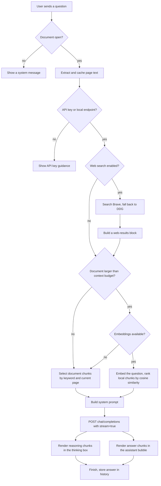
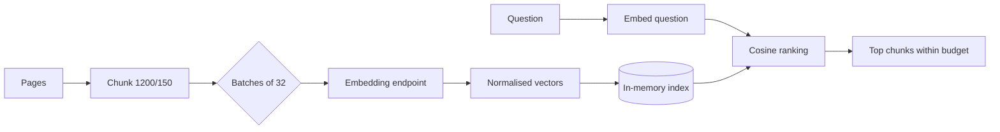
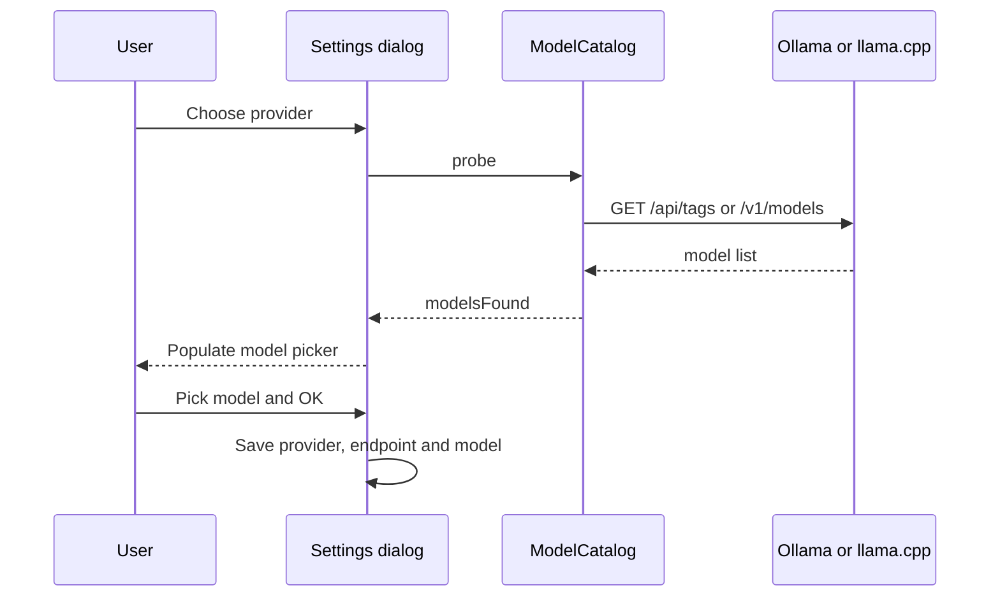

# AI mode — architecture and reference

This document describes how the AI mode in this Okular fork is built, how a
question becomes an answer, and where to extend it.

**Maintainer of this fork:** Chris-Onoh Chukwuebuka
<ebukaconoh@gmail.com>  
**Upstream:** KDE Okular, GPL-2.0-or-later

---

## 1. Design goals

1. **Okular stays Okular.** The document engine, generators, annotations, forms
   and printing are untouched. AI is an additive mode.
2. **No key in the repository.** Credentials are resolved at runtime and never
   compiled in.
3. **Local where possible.** Embeddings can run locally, and the full chat
   pipeline can point at a local OpenAI-compatible server.
4. **Minimal surface.** The shell exposes an icon rail, a chat panel and a few
   context actions; the main toolbar and menu bar are hidden by default.
5. **Graceful degradation.** If embeddings or web search fail, the assistant
   still answers from the document text.

---

## 2. Component map

| File | Responsibility |
| --- | --- |
| `shell/ai/aichatpanel.{h,cpp}` | Panel widget, orchestration, document extraction, retrieval, prompt construction, settings dialog |
| `shell/ai/chattranscript.{h,cpp}` | Scroll area, chat bubbles, Markdown rendering, thinking box, animations, edit/copy actions |
| `shell/ai/llmclient.{h,cpp}` | Streaming OpenAI-compatible chat client (SSE) |
| `shell/ai/embeddingclient.{h,cpp}` | Ollama and OpenAI-compatible embedding client |
| `shell/ai/websearchclient.{h,cpp}` | Keyless web search (Brave Search, DuckDuckGo fallback) |
| `shell/ai/aiconfig.{h,cpp}` | Configuration, key discovery and key-file parsing |
| `shell/ai/modelcatalog.{h,cpp}` | Asynchronous discovery of Ollama and llama.cpp models |
| `shell/shell.{h,cpp}` | Shell integration: rail sidebar, AI dock, hamburger, chrome hiding |
| `part/part.{h,cpp}` | Page context-menu AI actions and signals |
| `part/pageview.{h,cpp}` | Access to the selected text |
| `shell/welcomescreen.{h,cpp,ui}` | "Ask AI" entry point on the welcome screen |
| `icons/` | Fork icon based on Material `auto_awesome` (Apache-2.0) |

The AI panel never links against the part library. It talks to the active
`KParts` part through `QMetaObject::invokeMethod`, using these part slots:

| Slot | Returns |
| --- | --- |
| `pages()` | number of pages |
| `currentPage()` | 1-based current page |
| `currentDocument()` | local path or document identifier |
| `documentMetaData("Title")` | document title |
| `pageText(uint)` | extracted text for a page |

This keeps the dependency direction one-way and avoids ABI coupling between the
shell and the part.

---

## 3. High-level request flow



---

## 4. Document text extraction and caching

`AiChatPanel::ensureDocumentText()`:

1. Reads the page count from the active part.
2. Reads `currentDocument()` to identify the document.
3. Reuses the cached pages when the part, document ID and page count are
   unchanged.
4. Otherwise calls `pageText(page)` for every page, capped at **8 MiB** of
   extracted text per document.
5. Calls `QCoreApplication::processEvents()` every 16 pages so the UI stays
   responsive on large files.

The text is kept in memory only and is dropped by `documentChanged()` when the
active tab changes. Scanned PDFs without a text layer yield no context; OCR is
not included.

---

## 5. Context selection

### 5.1 Budget

`MaxContextChars` defaults to **48,000 characters** and is clamped to
4,000–400,000. The assistant always includes the current page when possible.

### 5.2 Keyword selection

For documents that fit the budget, and as a fallback when embeddings fail,
`buildContext()`:

1. Splits each page into chunks of **1,800 characters** with **200 characters of
   overlap**, preferring paragraph boundaries.
2. Scores chunks by term frequency of the question's keywords.
3. Adds the current page.
4. Greedily fills the budget, sampling evenly for overview questions such as
   "summarise".

Stop words and very short terms are filtered by `queryTerms()`; the tokenizer
supports Unicode letters and numbers.

### 5.3 Semantic retrieval

When the document is larger than the budget and an embedding backend is
configured, the panel builds an in-memory index:

- Chunks of **1,200 characters** with **150 characters of overlap**.
- At most **1,500 chunks** per document; larger documents are sampled evenly.
- Embeddings are requested in batches of **32**.
- Vectors are L2-normalised, so ranking uses a dot product (cosine similarity).
- The question is embedded once per query; the best chunks fill the budget.

The index is keyed by document ID and embedding model. Changing either, or
changing the embedding settings, invalidates it. There is no on-disk vector
cache yet.



### 5.4 Embedding backends

| Backend | Request | Default |
| --- | --- | --- |
| `ollama` | `POST /api/embed` with `{"model": ..., "input": [...]}` | `http://127.0.0.1:11434/api/embed`, `all-minilm` |
| `openai` | `POST /v1/embeddings` with `{"model": ..., "input": [...]}` | no default endpoint |
| `none` | keyword retrieval only | — |

Recommended local models:

| Model | Size | Notes |
| --- | --- | --- |
| `all-minilm` | about 46 MB | Fastest, English, default |
| `granite-embedding:30m` | about 60 MB | Very small |
| `nomic-embed-text` | about 274 MB | Better quality, long context |
| `embeddinggemma:300m` | about 300 MB | Multilingual |

Authenticated embedding endpoints are not supported yet; local Ollama and
unauthenticated `llama.cpp` servers are.

---

## 6. Prompt construction

The system prompt tells the model to:

- act as a document assistant inside Okular,
- answer from the provided excerpts,
- cite pages as `[page N]`,
- admit when the answer is not in the excerpts,
- stay concise.

The document context and, when enabled, the web-results block are appended to
the system message. Conversation history is sent in OpenAI format:

```json
[
  { "role": "system", "content": "You are Okular, ... document excerpts ..." },
  { "role": "user", "content": "..." },
  { "role": "assistant", "content": "..." },
  { "role": "user", "content": "..." }
]
```

History is trimmed to the last 20 messages. Document context is rebuilt for each
question; it is not accumulated in the history.

---

## 7. Streaming client

`LlmClient` sends:

```json
{
  "model": "deepseek-flash",
  "messages": [ ... ],
  "stream": true,
  "temperature": 0.2
}
```

Transport details:

- `Authorization: Bearer <key>`
- `Accept: text/event-stream`
- 180-second transfer timeout
- safe redirect policy

The parser consumes server-sent events line by line:

- `choices[0].delta.content` → answer text
- `choices[0].delta.reasoning_content` → reasoning text
- `[DONE]` terminates the stream
- error objects are surfaced as user-readable errors

If a server ignores `stream: true`, the client accepts a regular JSON response
with `choices[0].message.content` and `message.reasoning_content`.

Common HTTP errors are translated: 401 authentication, 402 insufficient
balance, 429 rate limit.

---

## 8. Thinking display

Reasoning is displayed only when the model emits `reasoning_content`.

- `ChatTranscript::beginAssistantMessage()` creates the bubble.
- `appendAssistantReasoning()` creates or updates the thinking box.
- `appendAssistantChunk()` finishes and collapses the thinking box as soon as
  the first answer token arrives.
- The **Thinking** pill in the panel header and the **Show the model's
  thinking** checkbox in AI settings both persist `ShowThinking`.
- When off, reasoning chunks are ignored, any open thinking box collapses, and
  the system prompt asks the model to answer directly without step-by-step
  reasoning.

The box animates its maximum height over 160 ms and truncates very long
reasoning at 6,000 characters.

`ShowThinking` is a cross-provider setting. It always controls the display and
the prompt, but it cannot force every provider to stop private reasoning:
reasoning models may still think internally before producing the answer. For
providers that expose a server-side switch, the correct place to change it is
the provider or model configuration.

The header controls use text labels (`Thinking`, `Web`) as well as icons so the
state is discoverable without hovering.

---

## 9. Web search

`WebSearchClient` uses no API key.

1. Query Brave Search:
   `https://search.brave.com/search?q=<query>&source=web`
2. Parse `<div class="snippet" data-type="web">` blocks for:
   - the first `href` (result URL),
   - `div.title` (title),
   - `div.content` (snippet).
3. If Brave fails or returns no organic results, retry DuckDuckGo:
   `https://html.duckduckgo.com/html/?q=<query>` and parse
   `result__a` / `result__snippet`, decoding the `uddg` redirect parameter.
4. Return at most six unique `http(s)` results.

Results are formatted as:

```text
Web search results (use when relevant and cite the URL):
1. Title
   https://example.com/page
   Snippet text
```

The prompt adds an instruction to mention source URLs inline when web
information is used. If both providers fail, the panel shows a notice and
continues with the document only.

Privacy: the search query is sent to Brave (and possibly DuckDuckGo). Disable
the globe toggle if queries must not leave the machine.

---

## 10. Chat transcript and UI behaviour

- User messages: accent bubble, aligned right, with edit and copy actions.
- Assistant messages: flat text, aligned left, with copy.
- Assistant output renders through `QTextDocument` with a small Markdown
  renderer (headings, lists, emphasis, code, links) and a regex that turns
  `[page N]` into `okular-page:N` links.
- Clicking a citation calls the part's `goToPage(uint)`.
- Streaming text is re-rendered at most every 80 ms.
- Auto-scroll follows the bottom only while the user is already at the bottom.
- New messages fade in over 180 ms; the thinking box expands and collapses in
  160 ms.
- Editing a user message rewinds the stored history and removes later messages
  from the transcript.

### Shell integration

- `Sidebar` is a `QDockWidget` containing a 46 px icon rail and a stacked widget
  for the part's sidebar. The part's tab bar is hidden; the rail drives it.
- The rail has three zones:
  1. hamburger menu button,
  2. one button per sidebar page (thumbnails, contents, annotations, ...),
  3. spacer, then the **AI mode** button.
- The AI chat is a right-side dock (`okular_ai_chat`) with an empty title bar,
  a 420 px minimum panel width and a 440 px default dock width.
- The menu bar and main toolbar are hidden after startup and after every
  `createGUI()` call. The hamburger button opens the part's `KHamburgerMenu`,
  which rebuilds the full curated menu.
- `Ctrl+Shift+A` toggles AI mode; `Ctrl+Shift+Space` focuses the composer.

---

## 11. Configuration and secrets

`AiConfig::load()` and `save()` use
`KSharedConfig::openConfig("okularairc")`, group `[AI]`. The `Provider` key is
one of `deepseek`, `ollama`, `llamacpp` or `custom`.

Key resolution order:

1. In-memory key entered in settings.
2. `OKULAR_AI_API_KEY`, `DEEPSEEK_API_KEY`, `OPENAI_API_KEY`.
3. Explicit key file from settings.
4. Auto-discovered Desktop/home file whose name contains `api` and `key`/`kes`.

`readApiKeyFromFile()` accepts raw tokens, dotenv assignments, JSON objects
(including nested objects and arrays), `key: value` lines and any single
`sk-...` token. Error messages never include file contents.

Key handling rules:

- The key is never logged.
- The key is never written to the source tree.
- Storing the key in `okularairc` is opt-in and uses plain text.
- Localhost endpoints use the placeholder `local` and need no key.

### 11.1 Local providers and model discovery

The settings dialog exposes four provider presets:

| Provider | Chat endpoint | Discovery |
| --- | --- | --- |
| `deepseek` | `https://api.deepseek.com/chat/completions` | Built-in model list (`deepseek-flash`, `deepseek-v4-pro`) |
| `ollama` | `http://127.0.0.1:11434/v1/chat/completions` | `GET /api/tags` |
| `llamacpp` | `http://127.0.0.1:8080/v1/chat/completions` | `GET /v1/models` |
| `custom` | whatever the user enters | `GET /v1/models` when the endpoint is local |

`ModelCatalog` probes the selected provider asynchronously with a four-second
timeout. The model combo is editable, so advanced users can type a model name
even when detection is unavailable.

Ollama discovery reads `models[].name` from `/api/tags` and hides common
embedding-only families (`minilm`, `nomic-embed`, `embeddinggemma`,
`granite-embedding`, `bge-`, `e5-`, `jina-embed`) so a non-technical user is not
offered a model that cannot chat. llama.cpp discovery reads `data[].id` from
`/v1/models`.

The settings dialog is deliberately split:

- **Provider and model** are always visible and are all a local user needs.
- **Advanced settings** (checkable group) contains the endpoint, API key file,
  session key, context budget and embedding options. It defaults to enabled for
  cloud providers and disabled for local providers.

If no key is configured and the endpoint is not localhost, the AI panel shows a
**Set up local AI** banner. It opens the same dialog with the Ollama preset
selected and discovery already running. The banner disappears as soon as a key
is available or a local endpoint is active.



---

## 12. Error handling summary

| Failure | Behaviour |
| --- | --- |
| No document | System message: open a document first |
| No API key | System message with settings guidance |
| Embedding server down | Notice, then keyword retrieval |
| Embedding vector count mismatch | Indexing aborts, keyword retrieval is used |
| Web provider blocked | Retry the other provider, then continue without web |
| Stream error object | Assistant message replaced by the error |
| HTTP 401/402/429 | Specific, actionable message |
| Empty response | "The server returned an empty response" |
| User stops generation | Partial answer is kept; "Generation stopped" notice |

---

## 13. Extension points

### Add a chat provider

Any OpenAI-compatible `/chat/completions` endpoint works. Set the endpoint,
model and key in AI settings; OpenRouter, Groq, Together, vLLM, llama.cpp and
Ollama all fit this shape.

### Add a model to the picker

Edit `AiChatPanel::updateModelCombo()` and add the model name to the list. The
current configuration model is always inserted if it is not already present.

### Add a search backend

Implement a parser in `WebSearchClient` and extend the `Backend` enum and the
retry order in `onReplyFinished()`. Keep results to unique `http(s)` URLs with a
title and snippet.

### Change the embedding backend

`EmbeddingClient` already supports Ollama and OpenAI-compatible `/v1/embeddings`
requests. Add another protocol by extending `setBackend()` and the request
builder.

### Add a shell action

The part emits `aiQueryRequested(QString)` and `aiAssistantRequested()`. The
shell connects them to `Shell::handleAiQuery()` and
`Shell::showAiAssistant()`, so new entry points only need to emit those signals.

---

## 14. Known limitations

- The index is in memory and is rebuilt when the document or model changes.
- At most 1,500 chunks are embedded per document; larger documents are sampled.
- Scanned PDFs without a text layer are not OCRed.
- Only the document in the active tab is available.
- Web search depends on the providers' HTML markup; parsers may need updates if
  their pages change.
- Reasoning display depends on the provider emitting `reasoning_content`.
- Authenticated embedding endpoints are not supported.
- The chat history is not persisted between sessions.

---

## 15. License

This documentation and the AI-mode implementation are part of a fork of KDE
Okular and are distributed under **GPL-2.0-or-later**, unless a file states
otherwise. The icon asset is Apache-2.0; see `icons/LICENSE.material-icons.md`.
